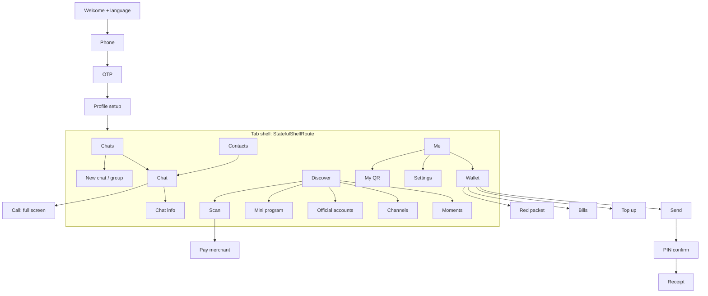

# EthioChat Design System v1.0

> **Agent: this file and `/mockups` are the single source of truth for every pixel.**
> The master build prompt defines *what* to build. This package defines *how it looks and feels*.
> If the two ever conflict on visuals, **this package wins**. Everything else in the master prompt still applies.

## 0. How to use this package

1. Copy `flutter/lib/core/design/` into `lib/core/design/` and `flutter/assets/brand/` into `assets/brand/`.
2. Merge `flutter/pubspec_snippet.yaml` into `pubspec.yaml`. Add the font files (Poppins Regular/Medium/SemiBold/Bold and Noto Sans Ethiopic Regular/Bold, both OFL licensed) to `assets/fonts/`.
3. Run `dart run flutter_launcher_icons` using `flutter/flutter_launcher_icons.yaml`.
4. In `MaterialApp.router` set `theme: buildEthioTheme(Brightness.light)`, `darkTheme: buildEthioTheme(Brightness.dark)`, `themeMode: ThemeMode.system`.
5. Import `package:<app>/core/design/design.dart` everywhere. **Never hard-code a colour, radius, spacing number or text style in a feature widget.** If something is missing, add it to the design layer first.
6. For each screen, open its mockup PNG in `/mockups` (light and dark versions exist) and match it. Build the screen from the shared widgets below.

Mockups were rendered with Poppins. Ge'ez text must render with Noto Sans Ethiopic in the real app (the mockup preview uses a fallback font for the language chips only).

## 1. Brand

- **Logo:** gold speech bubble with a black "E" whose middle arm ends in a dot (the typing indicator). Files in `brand/`.
- **Wordmark:** "Ethio" Poppins Medium in text colour + "Chat" Poppins Bold in gold gradient. Tagline: *Your world, one app.*
- **Clear space:** minimum = height of the "E" bar on every side. **Minimum size:** mark 24 dp, lockup 120 dp wide.
- Light surfaces use `logo-horizontal-light`, dark surfaces use `logo-horizontal-dark`. Never recolour the mark, rotate it, add effects or place it on a busy photo.
- Android adaptive icon: `adaptive-foreground` + `adaptive-background` + `adaptive-monochrome`. iOS/Play Store: `app-icon-1024.png` (square, no rounded corners, no transparency).

## 2. Colour tokens (`EthioColors`, `EthioPalette`)

| Token | Hex | Where |
|---|---|---|
| `black` | `#0B0B0B` | Dark background, text on light, text on gold, light-theme sent bubbles |
| `blackSoft` | `#1A1A1A` | Dark surfaces (cards `#161513`, nav `#121110`) |
| `cream` | `#FFF8E7` | Light background, text on dark |
| `creamDark` | `#F3E9CC` | Chips, icon tiles, dividers |
| `goldLight / gold / goldDeep` | `#F4D77A / #D4AF37 / #B8860B` | Brand accents and gradient stops |
| `danger` | `#C0392B` | Errors, destructive, call decline |
| `success` | `#2E7D4F` | Online dot, incoming money |

**Gold discipline (what makes it look expensive rather than cheap):**
- Shiny gold gradient **only** on: primary button, selected nav pill, wallet card, send/mic button, unread badge, accept-call, dark-mode sent bubble, logo.
- Everything else is cream/black with a *flat* gold accent (icons, links, focus ring, small headings).
- Never put gold text on cream. Use `goldDeep` for text on light, `gold` for text on dark. Text **on** gold is always black.
- One primary (gold) button per screen.

**Chat bubbles:** light theme = sent **black** with cream text and **gold ticks**, received white with a hairline border. Dark theme = sent **gold gradient** with black text and dark ticks, received `#1F1D19`. (Replaces the older "gold ticks everywhere" idea; read state = gold ticks on black, dark ticks on gold.)

## 3. Typography

Poppins for all Latin UI text, Noto Sans Ethiopic as fallback for Ge'ez. *(Overrides Inter in the master prompt.)* All sizes in `sp`, must scale with system font size up to 200% (never clamp text scale; let layouts wrap).

| Style | Size / weight | Use |
|---|---|---|
| `headlineMedium` | 28 / 700 | Tab titles (Chats, Contacts, Discover) |
| `titleLarge` | 22 / 700 | Sub-screen titles |
| `titleMedium` | 16 / 600 | List titles, section headers |
| `bodyLarge` | 15.5 / 400 | Message text, inputs |
| `bodySmall` | 13.5 / 400 | Previews, helper text |
| `labelLarge` | 16 / 600 | Buttons |
| `labelMedium` | 13 / 500 | Chips |
| `labelSmall` | 12 / 500 | Time, captions |

Numbers in money use tabular figures. Ge'ez line-height is 1.5 (taller glyphs); the theme handles this via `height` on Ge'ez locales, so do not set it per widget.

## 4. Layout, shape, motion

- Spacing grid 4 / 8 / 12 / 16 / 20 / 24 / 32 (`Sp`). Screen side padding **20**.
- Radius: chips 12, buttons/inputs/small cards 14, cards 18, wallet/sheets 24, avatars full.
- Touch targets ≥ 48 dp (primary actions 54). List rows 72 dp.
- Elevation is mostly borders (`1px line`), not shadows. Only the primary button and wallet card carry a soft gold shadow.
- Motion: 120 ms (taps), 220 ms (state changes), 360 ms (page). Curve `easeOutCubic`. Haptic `selectionClick` on button, tab and send. Respect "reduce motion".
- Pages: standard platform transitions. Bottom sheets for pickers and attachments, dialogs only for destructive confirmations, snackbars with **Undo** for reversible actions.
- Icons: outline, 2 px stroke, 22–24 dp. Use `lucide_icons_flutter` for an exact match with the mockups, or the `Icons.*_rounded` fallback already used in the widgets.

## 5. Shared widgets (all in `lib/core/design/widgets`)

| Widget | Purpose | Notes |
|---|---|---|
| `EthioButton` | All buttons | `kind`: primary, secondary, tonal, danger, text. `size`: large 54 / small 46. `loading`, `icon`. Disabled = 45% opacity. |
| `EthioTextField` | All text inputs | Gold focus ring, red error state with message below. |
| `EthioAvatar` | Users, groups | Initials on warm tones, optional photo and online dot. |
| `ChatListTile` | Chats list row | Pinned tint, unread badge (gold), muted badge (grey). |
| `MessageBubble` | Every message | `MessageStatus`: sending, sent, delivered, read, failed (tap to retry). `child` for voice, payment, image content. |
| `EthioBottomNav` | App shell | 4 tabs: Chats, Contacts, Discover, Me. Gold pill on selected. Badge support. |
| `WalletCard` | Wallet and Me | Balance in minor units, hide/show toggle. |
| `EthioMark`, `EthioWordmark` | Logo | Splash, welcome, about. |

Build any missing widget (section header, settings row, icon tile, empty state, offline banner, skeleton, voice-note bubble, media grid, QR card, PIN pad, OTP boxes) **in the same style and file location**, following the specs in section 7.

## 6. Navigation map

Rules: tab state is preserved when switching tabs. Back always returns to the previous screen, and from a tab root exits the app. Deep links from push open `/chats/:id`. The call screen and PIN pad are full-screen routes outside the shell. Paths are in `routes.dart`.

## 7. Screen specifications

Each row: mockup (light and dark exist as `<name>-light.png` / `-dark.png`), route, what to build, and required states. **Every screen must implement loading (skeleton), empty, error and offline states.**

| # | Mockup | Route | Key content | Special behaviour |
|---|---|---|---|---|
| 01 | `01-welcome` | `/welcome` | Logo, tagline, language chips, Get started | Default language from device; changing chip re-themes text immediately. |
| 02 | `02-phone` | `/auth/phone` | `+251` field, number field (formats `91 234 5678`), Send code, Telegram / Voice call alternatives | Accept `09…` and `+2519…`, normalise; disable button until valid; 3 codes per 10 min. |
| 03 | `03-otp` | `/auth/otp` | 6 boxes, resend timer 0:42, Verify, change number | Auto-read SMS, paste support, auto-submit on 6th digit, haptic on error shake. |
| 04 | `04-chats` | `/chats` | Title, search, new-chat gold button, filter chips (All, Unread, Groups, Official), `ChatListTile` list | Swipe: pin, mute, archive, delete. Pull to refresh. Offline banner under title. Empty state with "New chat". |
| 05 | `05-chat` | `/chats/:id` | Header (avatar, name, online/typing, video, call), day separators, bubbles, voice note, payment card, composer (plus, text, emoji, camera, mic/send) | Composer morphs mic→send when text exists. Hold mic to record, slide to cancel, up to lock. Swipe a bubble to reply. Long-press menu: reply, forward, copy, delete. Scroll-to-bottom chip with unread count. Gaps in `seq` fetched before render. |
| 06 | `06-contacts` | `/contacts` | Search, New friends, Group chats, Official accounts, A–Z grouped list, index rail | Index rail drag-scrub with haptic ticks. Invite button for non-users. |
| 07 | `07-discover` | `/discover` | Grouped rows (Moments, Channels, Official Accounts, Scan, People nearby), Mini programs grid | Red dot on Moments when new. Mini program icons load lazily and cache. |
| 08 | `08-wallet` | `/wallet` | `WalletCard`, six quick actions (Send, Receive, Scan, Top up, Bills, Red packet), recent activity | Incoming amounts green with `+`, outgoing neutral with `-`. Pull to refresh. Pending items show a clock chip. |
| 09 | `09-me` | `/me` | Profile card (avatar, name, Ethio ID, location chip, QR), Wallet, Favorites, Red packets, Privacy and security, Settings | Tapping the card opens profile edit. |
| 10 | `10-call` | `/call/:id` | Dark only. Gold-ring avatar, name, number, Decline (red), Accept (gold) | Full-screen intent, ringtone, vibrate. In-call screen reuses the layout with mute, speaker, camera, end. |
| 11 | `11-moments` | `/discover/moments` | Post cards (author, time, text, photo grid up to 9, like, comment) | Likes and comments only visible to mutual friends. Keyset pagination. |
| 12 | `12-components` | n/a | Buttons, inputs, chips, badges, message states, snackbar, offline banner | Reference for states of every control. |

**Screens not mocked yet (build in the same language):** profile setup, new chat / new group, chat info, search, settings and sub-pages, my QR, scan, send money, PIN pad, receipt, top up, bills, red packet, Channels player, official account page, mini program container, in-call screen, image viewer, attachment sheet.
Patterns to follow: grouped white cards on cream with 14 radius and hairline borders; 44 dp coloured icon tiles for rows; one gold primary button pinned near the bottom; sheet for choices; money amounts always `ETB 1,250.50`.

## 8. Content and tone

Short, warm, plain words. No jargon, no exclamation marks in errors.
- Error: "Couldn't send. Tap to retry." / Offline: "You are offline. Messages will send when you reconnect."
- Empty chats: "No chats yet. Start a conversation with a friend."
- Money: always show currency, 2 decimals, thousands separators; negative = `-`, never red unless failed.
- Dates: relative (Today, Yesterday, Mon), switch to Ethiopian calendar when the user chooses it.

## 9. Accessibility and low-end performance

- Contrast AA everywhere (verified for the token pairs above). Do not convey state by colour alone (ticks, badges and status text accompany colour).
- Every icon button has a `Semantics` label and tooltip. Support TalkBack, 200% text, bold text and reduce motion.
- Keep gradients/shadows to the places listed in section 2 (they are the expensive paint operations). Use `const` constructors, `RepaintBoundary` on chat list items, and `ListView.builder` with stable keys.
- Cache avatars and thumbnails; use blurhash placeholders; no full-size images in lists.

## 10. Acceptance checklist for the UI (agent must self-verify)

- [ ] No hard-coded colours, sizes or text styles outside `core/design`.
- [ ] Light and dark both match mockups at 1x and 2x font scale in English and Amharic (golden tests).
- [ ] Exactly one primary gold button per screen; gold gradient used only where listed.
- [ ] All touch targets ≥ 48 dp; all inputs have visible focus and error states.
- [ ] Every list has skeleton, empty, error and offline states.
- [ ] Bottom nav has exactly Chats, Contacts, Discover, Me.
- [ ] Message status icons follow `MessageStatus` and the outbox state machine.
- [ ] App icon and splash use the files in `brand/`; no re-drawn logo.
